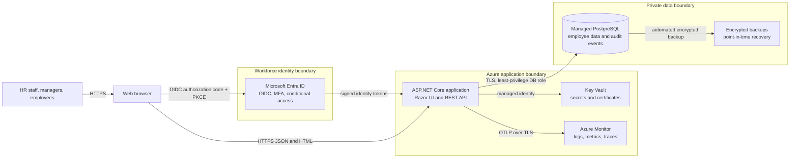
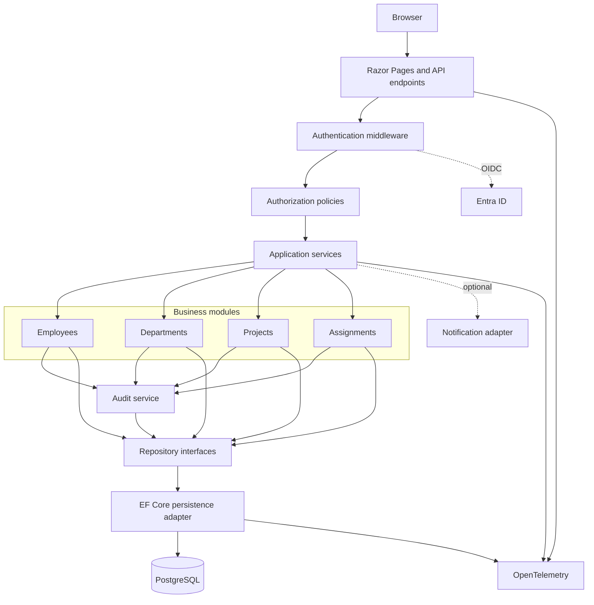
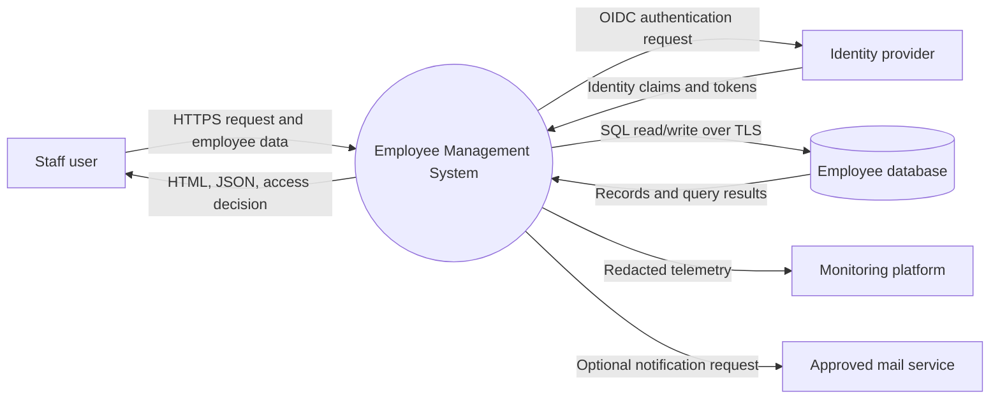
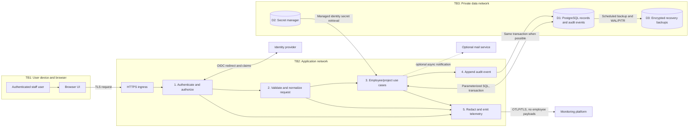

# Employee Management System Architecture

## 1. Scope and assumptions

### Confirmed

- The repository currently contains a database design and seed data for departments, employees, projects, and employee/project assignments.
- The SQLite seed contains 5 departments, 20 employees, 10 projects, and 12 assignments.
- There is no application code, identity provider, deployment target, traffic profile, or operational SLO in the repository.

### Assumptions for this proposal

- The application is an internal tool for HR staff, managers, and employees.
- Initial scale is hundreds to a few thousand users, with modest concurrent traffic and a small team.
- Employee names, work email, employment status, and salary are confidential personal data. Salary access is limited to authorized HR staff.
- Microsoft Entra ID is available for workforce sign-in. Azure is the default deployment recommendation because this fits the assumed identity provider; the design is portable to other clouds.
- Start with one deployable application and one relational database. Do not introduce microservices, queues, or a cache until measured requirements justify them.

If the intended user population, hosting provider, or regulatory requirements differ, revisit the identity, residency, availability, and recovery decisions before production.

## 2. Recommended technology stack

| Area | Recommendation | Reason |
|---|---|---|
| UI and application | ASP.NET Core 10 LTS with Razor Pages and REST endpoints | One deployable, mature authorization and validation ecosystem, server-rendered UI, and API support without requiring a separate frontend service. |
| Language | C# | Strong typing, broad enterprise support, good tooling for a small maintainable team. |
| Data access | EF Core with explicit migrations | Parameterized queries, transaction support, schema migration workflow, and testable persistence boundaries. |
| Production database | Managed PostgreSQL with private networking and point-in-time recovery | Concurrent writes, robust relational constraints, managed backups, and horizontal application scaling. |
| Local development | Existing SQLite database or disposable SQLite test database | Low setup cost. Keep migrations and queries portable; SQLite is not the recommended shared production database. |
| Identity | OpenID Connect authorization-code flow with PKCE via Microsoft Entra ID | No local password database; centralized MFA, conditional access, and account lifecycle. |
| Hosting | Azure App Service or an equivalent managed web-app service | Managed TLS, deployment slots, health checks, and low operational overhead. Use a private database endpoint. |
| Secrets | Azure Key Vault plus managed identity | Avoid credentials in source code, configuration files, or deployment variables. |
| Telemetry | OpenTelemetry APIs/exporters to Azure Monitor or a compatible backend | Vendor-neutral traces, metrics, and logs with consistent correlation. |
| CI/CD | GitHub Actions or Azure Pipelines | Automated quality gates, controlled migrations, and repeatable deployment. |

Avoid a separate SPA, microservices, Redis, Kafka, and Kubernetes initially. Add these only for a demonstrated need such as independent release cadence, sustained high read latency, asynchronous bulk processing, or infrastructure requirements that a managed app service cannot meet.

## 3. System architecture diagram

The system is a modular monolith. The browser and app communicate over HTTPS; the app uses OIDC for sign-in and TLS for database and telemetry integrations.



## 4. Component diagram

| Component | Responsibility | Interface and dependencies |
|---|---|---|
| Razor UI | Employee, department, project, and assignment screens | HTTPS; calls application services through the web host. |
| REST API | Versioned JSON endpoints for UI and approved integrations | `/api/v1`; validates input and invokes application services. |
| Authentication middleware | Validates OIDC session/token, issuer, audience, and expiry | Entra ID; establishes the authenticated principal. |
| Authorization policies | Enforces role and resource-level access | Claims from Entra groups/app roles plus application policy checks. |
| Employee module | Employee lifecycle and HR-controlled employee fields | Application commands/queries; employee repository. |
| Department module | Department records and employee membership | Application commands/queries; department repository. |
| Project module | Project lifecycle and project metadata | Application commands/queries; project repository. |
| Assignment module | Employee/project links, project roles, and allocation | Application commands/queries; assignment repository. |
| Audit service | Appends security-relevant changes and actor identity | Same database transaction as a protected change where practical. |
| Persistence adapter | EF Core mappings, migrations, transactions, and query implementation | PostgreSQL in production; SQLite for local use and selected tests. |
| Telemetry adapter | Structured logs, metrics, traces, and redaction | OpenTelemetry exporter to the configured observability backend. |
| Notification adapter (optional) | Sends approved workflow notifications | Email/Graph API; isolated behind an interface and never required to commit core records. |



Dependencies point inward: UI/endpoints call application services; application code depends on domain contracts and repository interfaces; infrastructure implements persistence and external adapters. Domain code must not depend on ASP.NET Core, EF Core, or cloud SDKs.

## 5. Data-flow diagrams

### Context-level DFD



### Detailed DFD and trust boundaries



Trust-boundary rules: treat all browser input as untrusted; authenticate before reading records; authorize each operation and sensitive field; restrict the database to the application network; keep secrets out of telemetry; do not send employee record payloads to the mail service.

## 6. Folder structure

The current repository is database-only. The following is the proposed application structure, not a claim that these source files already exist:

```text
employee-management/
  ARCHITECTURE.md
  README.md
  database/
    postgres/
      migrations/
      seed-dev.sql
    sqlite/
      employee_management_sqlite.sql
      employee_management.db
  src/
    EmployeeManagement.Web/
      Pages/
      Endpoints/
      Middleware/
      Authorization/
      Program.cs
    EmployeeManagement.Application/
      Employees/
      Departments/
      Projects/
      Assignments/
      Common/
    EmployeeManagement.Domain/
      Employees/
      Departments/
      Projects/
      Assignments/
      Common/
    EmployeeManagement.Infrastructure/
      Persistence/
      Identity/
      Telemetry/
      Notifications/
  tests/
    EmployeeManagement.UnitTests/
    EmployeeManagement.IntegrationTests/
    EmployeeManagement.ContractTests/
    EmployeeManagement.EndToEndTests/
  deploy/
    bicep/
    appservice/
  .github/
    workflows/
```

For a very small team, these boundaries can begin as folders in one solution and be split into projects only when dependency rules or team ownership require it. Keep migrations, development seed data, and production configuration separate. Never deploy the sample employee data to production.

## 7. Data and API design

### Database

- Preserve the current core model: `department` 1-to-many `employees`; `employees` many-to-many `projects` via `employee_projects`.
- Keep database constraints authoritative: unique department name, employee email and project code; nonnegative salary; valid status values; assignment allocation between 0 and 100; valid project date order.
- Use transactions for multi-row changes. For concurrent edits, add an optimistic concurrency token such as a `row_version`/updated timestamp and return `409 Conflict` on stale updates.
- Add production `audit_events` records for actor, action, entity key, timestamp, and approved changed-field metadata. Do not copy salary or full employee payloads into audit descriptions.
- Do not add a local password table. Identity and group membership belong to the identity provider.
- Use PostgreSQL migrations as the production source of truth. SQLite remains a local/demo option; test PostgreSQL-specific migrations and constraints against PostgreSQL in CI.
- Index common filters and joins based on measured query plans: employee department, status, normalized searchable name/email as policy allows, assignment project, and assignment employee. Avoid speculative indexes.
- Use soft termination/status transitions rather than deleting employee history. Define retention and correction procedures with HR/legal stakeholders.

### API conventions

- Use REST/JSON with `/api/v1` versioning, plural resource names, HTTPS only, and OpenAPI documentation.
- Use `GET` for reads, `POST` for creates/actions, `PUT` for full replacement, and `PATCH` for supported partial updates; use correct status codes and no sensitive details in errors.
- Validate server-side, normalize email consistently, set bounded page size, and use stable sorting plus cursor or keyset pagination for large lists.
- Return `application/problem+json` errors with a stable application error code and a correlation/trace ID.
- Enforce authorization at the endpoint and application-service boundary. Do not rely on hidden UI buttons.
- Make retried create/action requests idempotent where duplicate effects are harmful. Use an idempotency key only for operations that clients may safely retry.
- Treat salary as a separately authorized field: omit it from manager/employee responses unless required and explicitly permitted.

## 8. Security strategy

### Authentication and authorization

- Use OIDC authorization code flow with PKCE; require MFA and conditional access through the identity provider.
- Map identity-provider app roles/groups to application roles such as `HRAdmin`, `HRStaff`, `Manager`, and `Employee`. Define a least-privilege permission matrix before implementation.
- Enforce resource-level rules: managers may see only permitted direct reports; employees may see only their own profile; salary access is restricted to specifically authorized HR roles.
- Revalidate high-impact authorization server-side on every request. Use short-lived sessions/tokens and secure, HttpOnly, SameSite cookies for browser sessions.
- Use CSRF protection for cookie-authenticated state-changing requests, output encoding, and a restrictive Content Security Policy.

### Data protection and threat prevention

- TLS 1.2+ in transit; managed at-rest encryption for database, backups, logs, and storage. Consider application-level field encryption only if a documented threat model requires it; manage rotation through Key Vault.
- Use managed identity for app-to-cloud access and a dedicated least-privilege database role. Do not expose PostgreSQL publicly.
- Parameterize all database queries; validate input; use ORM APIs safely; avoid dynamic SQL for sort/filter fields unless allow-listed.
- Defend against OWASP Top 10 risks, including broken access control, injection, CSRF, XSS, SSRF, insecure deserialization, and security misconfiguration.
- Audit privileged access, role changes, salary changes, employee status changes, exports, and bulk operations. Restrict and review audit access.
- Limit exports, require authorization and audit events, use short-lived download links if files are needed, and avoid storing exports longer than policy permits.
- Use synthetic development data. Never copy production PII into development or CI.

### Secrets and threat model

| Threat | Primary mitigation |
|---|---|
| Stolen staff credentials | MFA, conditional access, short sessions, account revocation, anomaly alerts. |
| Manager or employee accesses unauthorized records | Deny-by-default policy, resource-level authorization, negative authorization tests, audit review. |
| SQL injection or malicious input | Parameterized access, server validation, least-privilege DB account, dependency/code scanning. |
| Data exfiltration through logs/export | Field-level log redaction, export authorization and auditing, egress controls, retention limits. |
| Database compromise or ransomware | Private endpoints, managed identity, encrypted backups, tested restore, restricted admin access. |
| Supply-chain compromise | Locked dependencies, SBOM, signed builds where available, automated vulnerability scanning, patch SLAs. |
| Secrets leaked to source or CI output | Key Vault/managed identity, secret scanning, log masking, rotation and revocation runbooks. |

## 9. Logging and observability

- Emit structured JSON logs with UTC timestamp, severity, service/version, environment, operation, trace ID, span ID, and a non-sensitive actor identifier where permitted.
- Propagate W3C `traceparent`/correlation IDs from ingress through application services and database spans. Accept external IDs only after validating length and characters; generate an ID if absent.
- Instrument HTTP server/client, EF Core/database calls, authentication outcomes, and key use cases using OpenTelemetry.
- Track request rate, error rate, latency percentiles, database pool saturation, query duration, failed sign-ins, authorization denials, queue depth if later introduced, and backup age/restore health.
- Dashboard: service health and SLOs; API latency/errors; database health; authentication/security events; backup and restore status.
- Alert on sustained elevated 5xx/latency, database availability or saturation, unusual authorization denials, repeated sign-in failures, backup failure, and expiring certificates/secrets.
- Redact names, email, salary, access tokens, session cookies, SQL parameters, and request/response bodies by default. Allow-list operational fields; never log full employee payloads.
- Set retention and access by data classification. Separate security audit records from diagnostic logs and protect them against ordinary application-user modification.

## 10. Exception handling and resilience

- Use centralized ASP.NET Core exception middleware and RFC 9457 Problem Details responses. Return safe messages and a trace ID; keep stack traces and SQL errors server-side.
- Map validation to `400`, unauthenticated to `401`, unauthorized to `403`, missing records to `404`, conflicts/stale versions to `409`, rate limits to `429`, and unexpected failures to `500`.
- Set explicit request, database-command, and external-call timeouts. Bound request size, page size, and concurrency.
- Retry only transient failures and only where safe; use exponential backoff with jitter and a small retry budget. Never retry validation, authorization, or constraint failures.
- For state-changing operations, rely on database transactions and idempotency/concurrency controls before retrying. Do not blindly retry a write with unknown commit outcome.
- Use circuit breakers and bulkheads for optional external services such as email; core employee reads/writes should not depend on email availability.
- On database outage, fail closed for protected data, return a retryable service-unavailable response, and do not silently fall back to stale or local production data.
- Provide health endpoints: liveness should check process health only; readiness may check required database connectivity without exposing credentials or schema details.

## 11. Testing strategy and CI/CD quality gates

| Test type | Coverage and gate |
|---|---|
| Unit | Domain rules, validation, permissions, salary visibility, status transitions; deterministic and database-free. |
| Integration | API, authorization middleware, transactions, migrations, constraints, and repositories against disposable PostgreSQL. SQLite tests are useful for fast local feedback but do not replace PostgreSQL tests. |
| Contract | OpenAPI compatibility and consumer expectations for any supported external client. |
| End-to-end | Sign-in test tenant, HR/manager/employee journeys, forbidden-access cases, and critical CRUD flows. Use synthetic data. |
| Security | SAST, dependency and secret scans on every PR; DAST in a test deployment; authorization-negative tests; periodic threat-model review and penetration test before sensitive production launch. |
| Performance | Representative read/write and search workloads; verify p95 latency, database pool behavior, pagination, and load headroom against agreed SLOs. |
| Resilience | Database disconnect, timeout, identity-provider outage, mail outage, restore-from-backup, and deployment rollback exercises. |

CI should fail on formatting/build errors, test failures, migration drift, critical/high vulnerabilities without an approved exception, secret leaks, API contract breaks, and failed authorization tests. Deployment pipeline: build immutable artifact, run migration review as a controlled job, deploy to staging, smoke test, then promote using a slot/canary. Do not run destructive migrations automatically at app startup. Keep migrations backward-compatible during rolling deployment and have a rollback/forward-fix plan.

## 12. Scalability, deployment, and recovery

### Scalability and performance

- Start with one application instance and a managed PostgreSQL tier sized from observed load. Stateless web nodes can scale horizontally behind managed ingress.
- Use server-side pagination, selected columns, query timeouts, appropriate indexes, and connection pooling. Avoid N+1 queries and unbounded exports.
- Add caching only for measured, non-sensitive reference data with explicit invalidation. Never cache salary or per-user authorization results in a shared cache without a reviewed isolation design.
- When background work is introduced, use a managed queue and an outbox pattern for reliable event publication rather than adding a broker preemptively.

### Deployment and environments

- Separate dev, test, staging, and production subscriptions/accounts and databases. Use private networking and least-privilege identities per environment.
- Keep app instances stateless. Store files only in managed object storage with encryption, retention, and access policies if file upload is later added.
- Use infrastructure as code, protected deployment approvals, immutable versioned artifacts, TLS, health probes, and deployment slots/canary.
- SQLite is suitable for the current local demo. Do not share one SQLite file over a network or use it for multi-instance production writes; migrate to PostgreSQL before production multi-user rollout.

### Disaster recovery

Provisional target (confirm with stakeholders): **RPO 15 minutes; RTO 4 hours**. Enable encrypted automated PostgreSQL backups and point-in-time recovery; use zone redundancy where the service tier/region supports it and business availability justifies the cost. Replicate backups to a separate region if regional loss is in scope. Back up infrastructure configuration and secrets metadata, not secret values in plaintext.

Run a documented restore test at least quarterly and after material database changes. Record restore duration, data loss window, owners, and validation queries. Recovery must include identity configuration, DNS/network, application deployment, database, and audit history. Define retention, legal hold, deletion, and breach-notification procedures with the organization’s privacy/legal owners.

## 13. Decisions, trade-offs, and risks

| Decision | Rationale and trade-off |
|---|---|
| Modular monolith, not microservices | Lower operational and team complexity; all modules share a release and database. Split only when independent scaling/ownership becomes a real constraint. |
| PostgreSQL production, SQLite local | Strong multi-user concurrency, managed recovery, and horizontal app scale in production; SQLite remains easy for demos and local development. Requires migration testing and some provider-specific adaptation. |
| Server-rendered Razor UI plus API | One application and deployment, adequate for standard HR workflows; choose a separate SPA only if richer client-side interaction or independent frontend delivery is required. |
| External OIDC identity | Central MFA and lifecycle, no password handling; depends on identity-provider availability and configuration. Define a controlled emergency admin path. |
| Managed platform services | Reduced patching and operational burden; cloud service cost and provider dependency. Keep app portable with standard HTTP, OIDC, PostgreSQL, and OpenTelemetry interfaces. |
| Audit data in relational store initially | Transactional and simple to operate; privileged database operators may still alter records. For stronger tamper evidence, export to immutable/WORM storage and alert on gaps. |

### Open risks and decisions

- Confirm whether access is internal-only and whether managers can view direct reports, salary, or project allocations.
- Confirm applicable privacy, employment, residency, retention, and audit requirements before production data is loaded.
- Agree availability SLO, budget, regional failover requirement, RPO/RTO, expected peak concurrency, and support ownership.
- Confirm whether employee records are mastered here or synchronized from an HRIS; if synchronized, specify source-of-truth, conflict handling, and deletion semantics.
- The seed dataset is synthetic and the current SQLite file is a development artifact, not a production database or backup strategy.

## 14. Implementation sequence

1. Confirm assumptions, permission matrix, data classification, SLO, and recovery targets with HR/security/operations.
2. Create the ASP.NET Core solution with modular boundaries, OIDC, authorization policies, migrations, and PostgreSQL integration tests.
3. Implement read workflows and least-privilege access first; add writes with validation, audit transactions, optimistic concurrency, and negative authorization tests.
4. Add telemetry, dashboards, alerting, backup/restore automation, and operational runbooks before production onboarding.
5. Pilot with synthetic or approved limited data; load-test, run DAST, exercise recovery, and obtain security/privacy sign-off.
6. Deploy with staged promotion and migrate/import real data only through a reviewed, auditable migration process.