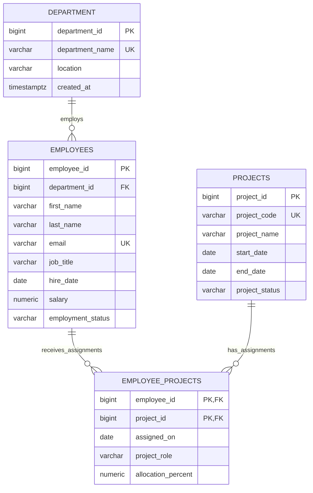

# Employee Management System Database

> This repository now includes **InsightSQL**, a local-first natural-language SQL workbench. Its application setup is in [INSIGHTSQL.md](INSIGHTSQL.md); the database design and seed details remain below.

## Database choice

This design targets PostgreSQL 12 or later. Run `employee_management.sql` in a new or otherwise empty database. It creates the schema and inserts sample records.

An SQLite version is also included. `employee_management_sqlite.sql` is the SQLite-compatible schema and seed script, and `employee_management.db` is the populated SQLite database file.

## ER diagram

## Relationships

- One department can have zero or many employees; each employee belongs to exactly one department.
- Employees and projects have a many-to-many relationship through `employee_projects`.
- An employee/project pair can appear only once because the junction table uses a composite primary key.
- Department deletion is restricted while employees reference it. Deleting an employee or project cascades to its assignments. Updates to referenced IDs cascade.

## Table definitions

`PK` means primary key, `FK` means foreign key, `UQ` means unique, and `NULL` means optional.

### `department`

| Column | Type | Rules | Description |
|---|---|---|---|
| `department_id` | `BIGINT` | PK, generated identity | Department identifier. |
| `department_name` | `VARCHAR(100)` | NOT NULL, UQ | Department name. |
| `location` | `VARCHAR(150)` | NULL | Office or location. |
| `created_at` | `TIMESTAMPTZ` | NOT NULL, default `CURRENT_TIMESTAMP` | Creation timestamp with time zone. |

### `employees`

| Column | Type | Rules | Description |
|---|---|---|---|
| `employee_id` | `BIGINT` | PK, generated identity | Employee identifier. |
| `department_id` | `BIGINT` | NOT NULL, FK to `department.department_id` | Employee's department. |
| `first_name` | `VARCHAR(80)` | NOT NULL | Employee's first name. |
| `last_name` | `VARCHAR(80)` | NOT NULL | Employee's last name. |
| `email` | `VARCHAR(254)` | NOT NULL, UQ | Employee email address. |
| `job_title` | `VARCHAR(120)` | NOT NULL | Current job title. |
| `hire_date` | `DATE` | NOT NULL | Employment start date. |
| `salary` | `NUMERIC(12, 2)` | NOT NULL, CHECK >= 0 | Salary amount. |
| `employment_status` | `VARCHAR(20)` | NOT NULL, default `active` | One of `active`, `on_leave`, or `terminated`. |

### `projects`

| Column | Type | Rules | Description |
|---|---|---|---|
| `project_id` | `BIGINT` | PK, generated identity | Project identifier. |
| `project_code` | `VARCHAR(30)` | NOT NULL, UQ | Stable project code. |
| `project_name` | `VARCHAR(150)` | NOT NULL | Project name. |
| `start_date` | `DATE` | NULL | Planned or actual start date. |
| `end_date` | `DATE` | NULL, CHECK >= start date when both dates exist | Planned or actual end date. |
| `project_status` | `VARCHAR(20)` | NOT NULL, default `planned` | One of `planned`, `active`, `on_hold`, or `completed`. |

### `employee_projects`

| Column | Type | Rules | Description |
|---|---|---|---|
| `employee_id` | `BIGINT` | PK part, NOT NULL, FK to `employees.employee_id` | Assigned employee. |
| `project_id` | `BIGINT` | PK part, NOT NULL, FK to `projects.project_id` | Assigned project. |
| `assigned_on` | `DATE` | NOT NULL, default `CURRENT_DATE` | Assignment date. |
| `project_role` | `VARCHAR(100)` | NULL | Employee's role on the project. |
| `allocation_percent` | `NUMERIC(5, 2)` | NOT NULL, default `100.00`, CHECK from 0 to 100 | Percentage of work allocation. |

## Primary and foreign keys

| Table | Primary key | Foreign key |
|---|---|---|
| `department` | `department_id` | None |
| `employees` | `employee_id` | `department_id` references `department.department_id` (`ON UPDATE CASCADE`, `ON DELETE RESTRICT`) |
| `projects` | `project_id` | None |
| `employee_projects` | Composite (`employee_id`, `project_id`) | `employee_id` references `employees.employee_id`; `project_id` references `projects.project_id` (both `ON UPDATE CASCADE`, `ON DELETE CASCADE`) |

Unique keys: `department.department_name`, `employees.email`, and `projects.project_code`. Indexes support lookups by `employees.department_id` and `employee_projects.project_id`.

## Sample data

The seed inserts **5 departments, 20 employees, 10 projects, and 12 employee/project assignments**. Each department has four employees. The insert statements resolve foreign keys using department names, employee emails, and project codes rather than assuming generated numeric IDs.

## SQL scripts

[`employee_management.sql`](employee_management.sql) contains both script sections in execution order:

1. `CREATE TABLE` statements for all four tables, constraints, and supporting indexes.
2. `INSERT` statements for the sample departments, employees, projects, and employee/project assignments.

Run the file once in a new or empty PostgreSQL database. The sample inserts use unique values and are not intended to be rerun in a database that already contains these records.